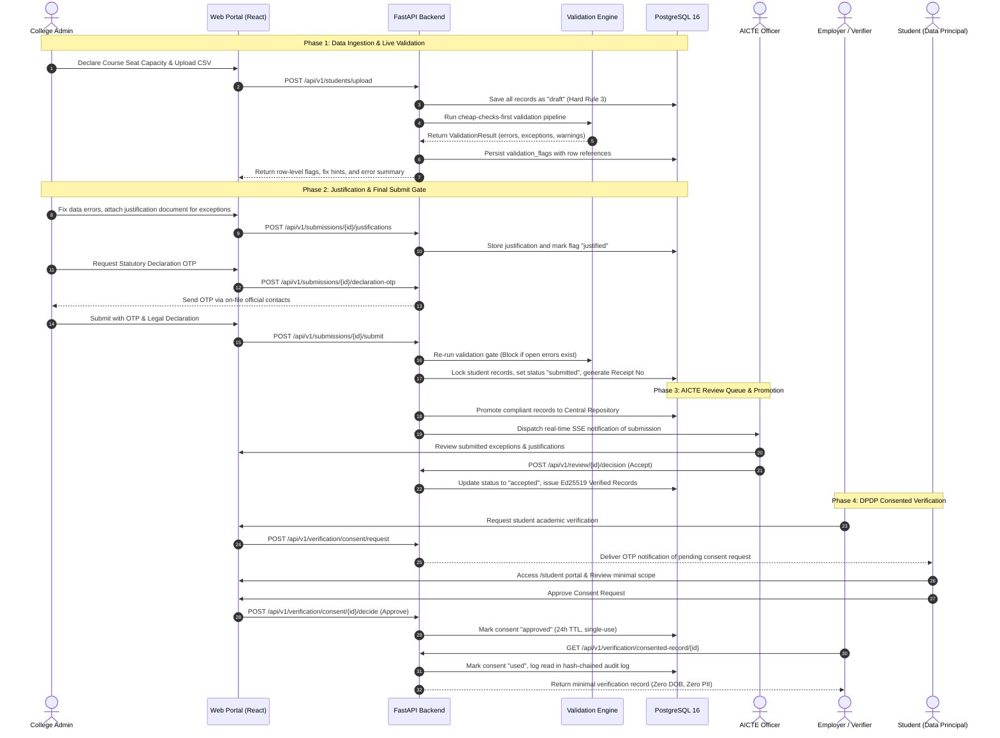

# APAAR Platform: System Architecture & Technical Specifications

This document details the system topology, end-to-end data lifecycle, validation engine pipeline, intelligent anomaly detection subsystem, REST API architecture, and Digital Personal Data Protection (DPDP) compliance frameworks of the **APAAR Student Data Management and Verification System**.

---

## 1. High-Level System Architecture & Topology

The platform is designed as a modular, vertical-slice architecture that connects higher educational institutions, the All India Council for Technical Education (AICTE), employers, and students via an automated data governance and cryptographic verification pipeline.

```mermaid
flowchart TD
    subgraph Clients["Stakeholders & Ingestion Clients"]
        U1["College Admin & Staff (Web UI)"]
        U2["AICTE Compliance Officers & Admins (Web UI)"]
        U3["Authorized Verifiers / Employers (Web UI)"]
        U4["Enrolled Students (DPDP Consent Portal)"]
        U5["Institutional ERPs (Bulk JSON API Client)"]
    end

    subgraph Edge["Security, Network & Gateway Layer"]
        MW1["SecurityHeadersMiddleware (HSTS, CSP, X-Frame)"]
        MW2["RequestBodySizeLimiterMiddleware (15MB Limit)"]
        MW3["CORS Policy Enforcement (Strict Origin Whitelist)"]
        MW4["Redis Sliding-Window Rate Limiter (ZSET)"]
        MW5["ApaarIdMaskingFilter (Runtime Log Redaction)"]
    end

    subgraph Backend["FastAPI Core Application Services"]
        S_AUTH["Auth & MFA Engine (Argon2id, JWT, pyotp)"]
        S_INST["Institution & Intake Management Service"]
        S_VAL["Automated Validation Engine (Pure Rules)"]
        S_SUB["Submissions State Machine & Gatekeeper"]
        S_REV["AICTE Review Queue & Query Engine"]
        S_ANOM["Anomaly Detection & IsolationForest ML"]
        S_CRYPTO["Cryptographic Signing & QR Service (Ed25519)"]
        S_VERIF["DPDP Student Consent & Verification Service"]
        S_REP["Statutory Reporting Engine (CSV, XLSX, PDF)"]
        S_AUDIT["SHA-256 Hash-Chained Audit Logger"]
    end

    subgraph Persistence["State & Persistence Layer"]
        DB[("PostgreSQL 16 Database
        (26 Tables, Encrypted DOB, Foreign Keys)")]
        CACHE[("Redis 7 In-Memory Cache
        (OTP TTL, Sliding Window, SSE Pub/Sub)")]
        STORAGE["Local File Storage
        (Content-Addressable Evidence Documents)"]
    end

    subgraph Interfaces["External Integration Interfaces & Mocks"]
        I_APAAR["ApaarClient (Batched Registry Lookup)"]
        I_AICTE["AicteMasterClient (30 Colleges, Master Sync)"]
        I_OTP["OtpSender (Redis TTL & dev_outbox Logging)"]
        I_ID["IdentityVerifier (Signatory Verification)"]
        I_STORE["Storage (Local Disk / S3 Compatible)"]
    end

    Clients --> Edge
    Edge --> Backend
    Backend --> Persistence
    Backend --> Interfaces
```

---

## 2. End-to-End Data Ingestion & Verification Lifecycle

The following sequence diagram illustrates the complete student data lifecycle: from institutional intake declaration and draft upload, through automated validation, statutory declaration, AICTE review, cryptographic signing, and DPDP-compliant verification.

---

## 3. Validation Engine Architecture & Execution Pipeline

The validation engine serves as the single source of truth across single student form entry, CSV bulk uploads, ERP integrations, and submission gate checks (per **SPEC.md Section 2 (Hard Rule 4)**).

### 3.1 Cheap-Checks-First Execution Hierarchy
Validation rules execute in a strict deterministic order to eliminate computational overhead:

1. **File Scope (`file`)**: Template header conformity (`FILE_TEMPLATE`), non-empty payload check (`FILE_EMPTY`), max row limits (`FILE_TOO_LARGE`), intra-file duplicate APAARs (`DUP_APAAR_IN_FILE`), and duplicate enrolment numbers (`DUP_ENROLNO_IN_COURSE`).
2. **Row Scope (`row`)**: Structural field formatting (`APAAR_FORMAT`, `NAME_FORMAT`, `DOB_INVALID`, `ENUM_INVALID`), mandatory fields (`APAAR_REQUIRED`, `NAME_REQUIRED`, `COUNTRY_REQUIRED`), external batched registry lookups (`APAAR_NOT_FOUND`, `APAAR_DOB_MISMATCH`), fuzzy name resolution via RapidFuzz (`APAAR_NAME_MISMATCH`), admission calendar window bounds (`ADMISSION_DATE_WINDOW`, `ADMISSION_YEAR_MISMATCH`), course authorization (`COURSE_NOT_APPROVED`), and demographic consistency (`CATEGORY_CONFLICT`, `AGE_OUT_OF_RANGE`, `SEAT_TYPE_NOT_APPROVED`, `MODE_CATEGORY_MISMATCH`).
3. **Course Scope (`course`)**: Statutory intake capacity enforcement (`INTAKE_EXCEEDED`), supernumerary limits (`SUPERNUMERARY_EXCEEDED`), and institutional seat declaration reconciliation (`SEAT_DECLARATION_MISMATCH`).
4. **Cross-College Scope (`cross`)**: Inter-institutional duplicate active enrolments (`DUP_ACTIVE_OTHER_COLLEGE`, `DUP_SAME_COURSE_OTHER_COLLEGE`) evaluated across the central database index on `(apaar_id, academic_year)`.
5. **Anomaly Scope (`anomaly`)**: Statistical growth spikes, demographic clusters, contiguous sequential APAAR generation, and multivariate Machine Learning outlier scoring.

### 3.2 Severity Level Hierarchy & Gate Enforcement

| Level | Severity & Definition | Effect on Submission Gate | Justification Policy | UI Presentation |
|---|---|---|---|---|
| **`error`** | Factual mistakes in data formatting, syntax, or invalid identifiers. | **Strictly Blocks Submit**; cannot proceed until fixed in data. | Cannot be justified (HTTP 400). | Red filled badge |
| **`exception`** | Real-world compliance anomalies (e.g. enrolment exceeding intake quota). | Permitted to submit **only with written justification and evidence**. | Mandatory justification and document upload. | Red outlined (2px) badge |
| **`warning`** | Suspicious or unusual patterns (e.g. age outlier, date window mismatch). | Permitted to submit. | Optional written justification. | Amber filled badge |
| **`info`** | Informational observations (e.g. single-day admission concentration). | Permitted to submit. | No justification required. | Grey filled badge |

### 3.3 Dynamic Rule Configuration (`rule_config`)
Rule severity levels, activation status, and parameters are stored in the PostgreSQL `rule_config` table. Administrators (`aicte_admin`) can dynamically adjust parameters (such as fuzzy name thresholds or age band ranges) via `PUT /api/v1/rules/{rule_code}` without restarting application services or deploying new code.

---

## 4. Intelligent Anomaly Detection Subsystem

Per **SPEC.md Section 9.3** and **TASKS.md T27**, the anomaly engine monitors systemic patterns and institutional irregularities across 6 key statistical and machine learning dimensions. Anomaly flags are tagged with audience `aicte`, alerting supervisory officers without blocking institutional submissions.

### 4.1 Anomaly Rule Specifications

| Rule Code | Scope | Default Level | Default Threshold | Mathematical Basis / Description |
|---|---|---|---|---|
| `ANOM_ENROLMENT_JUMP` | `anomaly` | `warning` | $> 30.0\%$ growth | Measures sudden unapproved expansions in enrolment compared to previous academic year. |
| `ANOM_NRI_SHARE` | `anomaly` | `warning` | $> 25.0\%$ share | Proportion of NRI, OCI, and foreign national candidates exceeding authorized quota bands. |
| `ANOM_SUPERNUM_SHARE` | `anomaly` | `warning` | $> 15.0\%$ share | Supernumerary seat utilization (Tuition Fee Waiver, special quotas) exceeding statutory norms. |
| `ANOM_DOB_CLUSTER` | `anomaly` | `warning` | $\ge 5$ students | Unnatural demographic clustering where multiple candidates in the same course share an identical date of birth. |
| `ANOM_SEQUENTIAL_APAAR` | `anomaly` | `warning` | $\ge 10$ consecutive | Consecutive contiguous runs of national 12-digit student IDs indicative of bulk robotic generation. |
| `ANOM_SAME_ADMISSION_DAY` | `anomaly` | `info` | $\ge 60.0\%$ share | High concentration of students admitted on a single calendar day outside regular counseling cycles. |
| `ANOM_MODEL_SCORE` | `anomaly` | `warning` | Score $< -0.05$ | Multivariate IsolationForest outlier score indicating unusual multi-dimensional course profiles. |

---

### 4.2 Machine Learning Model: IsolationForest (`ANOM_MODEL_SCORE`)

The multivariate anomaly model utilizes scikit-learn's **IsolationForest** (`sklearn.ensemble.IsolationForest`). IsolationForest isolates anomalies by constructing ensembles of random partition decision trees. Because anomalies represent atypical instances with minority values, they require significantly fewer random splits to isolate and appear near the root of the decision trees.

#### Mathematical Formulation

Given an ensemble of $T$ isolation trees over a dataset of $n$ instances:
1. **Path Length $h(x)$**: The number of edges traversed from the root node to the terminating leaf node for instance $x$.
2. **Average Path Length $c(n)$**: The average path length of unsuccessful searches in a Binary Search Tree (BST):
   $$c(n) = 2 \ln(n - 1) + 0.5772156649\ (\text{Euler-Mascheroni constant}) - \frac{2(n - 1)}{n}$$
3. **Anomaly Score $s(x, n)$**:
   $$s(x, n) = 2^{-\frac{E(h(x))}{c(n)}}$$
   - When $E(h(x)) \to 0$, $s \to 1$ (strong anomaly).
   - When $E(h(x)) \to c(n)$, $s \to 0.5$ (normal instance).
   - In scikit-learn's `decision_function(x)`: scores are shifted such that negative values correspond to anomalies ($s > 0.5$) and positive values correspond to normal inliers.

#### Model Hyperparameters
- `n_estimators`: 100 decision trees.
- `contamination`: 0.08 (expected proportion of institutional outliers).
- `random_state`: 42 (deterministic reproducibility).
- `bootstrap`: False.

---

### 4.3 6-Dimensional Feature Vector Formulation

For every college-course combination $(I, C)$ in academic year $Y$:

$$\mathbf{X}_{(I, C, Y)} = \begin{bmatrix} x_{\text{yoy}}, & x_{\text{nri}}, & x_{\text{super}}, & x_{\text{dob}}, & x_{\text{adm}}, & x_{\text{seq}} \end{bmatrix}^T$$

1. **Year-over-Year Growth ($x_{\text{yoy}}$)**:
   $$x_{\text{yoy}} = \frac{N_{\text{active}}(I, C, Y) - N_{\text{active}}(I, C, Y-1)}{\max(N_{\text{active}}(I, C, Y-1), 1)}$$

2. **International Quota Share ($x_{\text{nri}}$)**:
   $$x_{\text{nri}} = \frac{N_{\text{intl}}(I, C, Y)}{N_{\text{active}}(I, C, Y)}$$
   Where $N_{\text{intl}}$ counts students with $\text{NRI}=\text{Yes}$, $\text{OCI}=\text{Yes}$, $\text{Foreign National}=\text{Yes}$, or international quota mode.

3. **Supernumerary Share ($x_{\text{super}}$)**:
   $$x_{\text{super}} = \frac{N_{\text{supernumerary}}(I, C, Y)}{N_{\text{active}}(I, C, Y)}$$

4. **DOB Cluster Ratio ($x_{\text{dob}}$)**:
   $$x_{\text{dob}} = \frac{\max_{d \in \text{DOBs}} \text{count}(d)}{N_{\text{active}}(I, C, Y)}$$

5. **Admission-Day Concentration ($x_{\text{adm}}$)**:
   $$x_{\text{adm}} = \frac{\max_{t \in \text{Dates}} \text{count}(t)}{N_{\text{active}}(I, C, Y)}$$

6. **Sequential APAAR Run Length ($x_{\text{seq}}$)**:
   $$x_{\text{seq}} = \max_{k} \left| \{ a_i \mid a_{j+1} = a_j + 1 \} \right|$$

---

## 5. REST API Architecture & Endpoint Reference

The backend exposes 18 modular API routers under `/api/v1` with deny-by-default role-based access control (RBAC).

### 5.1 System & Platform Introspection

| Method | Endpoint | Allowed Roles | Description | Response Code |
|---|---|---|---|---|
| `GET` | `/api/v1/health` | Public | System status, PostgreSQL/Redis connectivity check, demo mode indicator. | 200 OK |
| `GET` | `/api/v1/privacy` | Public | Machine-readable DPDP compliance specification, 16 minimised fields, DPO details. | 200 OK |
| `GET` | `/api/v1/dev/outbox` | Public (Dev mode) | Read mock SMS/OTP outbox notifications for local debugging. | 200 OK |

---

### 5.2 Authentication, Sessions & Scoped API Keys

| Method | Endpoint | Allowed Roles | Description | Response Code |
|---|---|---|---|---|
| `POST` | `/api/v1/auth/login` | Public | Authenticate with email/password; returns JWT or prompts MFA challenge. | 200 OK |
| `POST` | `/api/v1/auth/refresh` | Public (Bearer) | Refresh short-lived access token using valid refresh token. | 200 OK |
| `POST` | `/api/v1/auth/mfa/challenge` | Public | Initiate TOTP or OTP challenge for pending multi-factor authentication. | 200 OK |
| `POST` | `/api/v1/auth/mfa/verify` | Public | Complete MFA verification; returns authenticated JWT session tokens. | 200 OK |
| `GET` | `/api/v1/auth/me` | Authenticated | Retrieve authenticated user profile, assigned role, and institution ID. | 200 OK |
| `POST` | `/api/v1/auth/logout` | Authenticated | Revoke active user session and invalidate refresh tokens. | 200 OK |
| `GET` | `/api/v1/college/api-keys` | `college_admin` | List scoped integration API keys created for the institution. | 200 OK |
| `POST` | `/api/v1/college/api-keys` | `college_admin` | Generate a new SHA-256 hashed API key with granular permission scopes. | 201 Created |
| `DELETE` | `/api/v1/college/api-keys/{id}` | `college_admin` | Immediately revoke an integration API key. | 200 OK |

---

### 5.3 Institutions, Courses & AICTE Master Data

| Method | Endpoint | Allowed Roles | Description | Response Code |
|---|---|---|---|---|
| `GET` | `/api/v1/institutions` | AICTE Roles | Search and list all higher educational institutions in master directory. | 200 OK |
| `GET` | `/api/v1/institutions/{id}` | Authenticated | Retrieve institution profile, official contacts, and approval status. | 200 OK |
| `GET` | `/api/v1/institutions/{id}/courses` | Authenticated | Retrieve list of approved academic courses, branches, and levels. | 200 OK |
| `GET` | `/api/v1/institutions/{id}/intake-history` | Authenticated | View historical audit log of AICTE approved intake changes per year. | 200 OK |
| `PUT` | `/api/v1/institutions/{id}/intake` | `aicte_officer`, `aicte_admin` | Update approved intake or supernumerary seats; triggers validation re-runs. | 200 OK |
| `POST` | `/api/v1/institutions/activation/claim` | Public | Claim unactivated institution by AICTE ID; sends OTP to on-file contact. | 200 OK |
| `POST` | `/api/v1/institutions/activation/verify-otp` | Public | Verify activation OTP; unlocks signatory verification step. | 200 OK |
| `POST` | `/api/v1/institutions/activation/submit` | Public | Submit head of institution credentials and authorisation letter. | 201 Created |
| `GET` | `/api/v1/institutions/activation/requests` | `aicte_officer`, `aicte_admin` | AICTE officer queue of pending institution activation requests. | 200 OK |
| `POST` | `/api/v1/institutions/activation/decide` | `aicte_officer`, `aicte_admin` | Approve or reject activation request; creates `college_admin` user. | 200 OK |
| `GET` | `/api/v1/institutions/staff` | `college_admin` | List all staff accounts created under the caller's institution. | 200 OK |
| `POST` | `/api/v1/institutions/staff` | `college_admin` | Create new staff user (`college_staff` or `college_viewer`). | 201 Created |
| `POST` | `/api/v1/institutions/corrections` | `college_admin` | Submit an official request to AICTE to modify institution contacts. | 201 Created |
| `POST` | `/api/v1/institutions/aicte/sync` | `aicte_admin` | Synchronize institutions and courses with AICTE master registry. | 200 OK |

---

### 5.4 Student Records, Seat Declarations & Ingestion

| Method | Endpoint | Allowed Roles | Description | Response Code |
|---|---|---|---|---|
| `GET` | `/api/v1/students` | College Roles | Paginated filterable grid of student records (status, level, course, year). | 200 OK |
| `GET` | `/api/v1/students/{id}` | College Roles | Retrieve single student record details, encrypted DOB, and active flags. | 200 OK |
| `POST` | `/api/v1/students` | `college_admin`, `college_staff` | Create single student record; executes validation and saves as draft. | 201 Created |
| `PUT` | `/api/v1/students/{id}` | `college_admin`, `college_staff` | Update draft student record fields and re-evaluate validation flags. | 200 OK |
| `DELETE` | `/api/v1/students/{id}` | `college_admin`, `college_staff` | Delete unlocked draft student record. | 200 OK |
| `POST` | `/api/v1/students/upload` | `college_admin`, `college_staff` | Bulk upload student records via CSV/XLSX file; saves all rows as drafts. | 200 OK |
| `GET` | `/api/v1/students/seat-declarations` | College Roles | Retrieve college declared seat counts vs approved intake per course. | 200 OK |
| `POST` | `/api/v1/students/seat-declarations` | `college_admin`, `college_staff` | Upsert declared seat counts per course and year (autosaved draft). | 200 OK |
| `POST` | `/api/v1/integration/students/bulk` | API Key (`students:write`) | High-throughput JSON ERP student ingestion with idempotency caching. | 200 OK |

---

### 5.5 Submissions, Review Queue & Change Requests

| Method | Endpoint | Allowed Roles | Description | Response Code |
|---|---|---|---|---|
| `GET` | `/api/v1/submissions` | College Roles | List submission records and approval status for caller's institution. | 200 OK |
| `POST` | `/api/v1/submissions/{id}/validate` | `college_admin`, `college_staff` | Manually trigger full validation engine re-run across submission. | 200 OK |
| `POST` | `/api/v1/submissions/{id}/justifications` | `college_admin`, `college_staff` | Attach written text and evidence document for an exception/warning flag. | 201 Created |
| `POST` | `/api/v1/submissions/{id}/declaration-otp` | `college_admin` | Dispatch OTP for statutory declaration prior to submission lock. | 200 OK |
| `POST` | `/api/v1/submissions/{id}/submit` | `college_admin` | Final statutory submission gate; validates OTP, locks data, issues receipt. | 200 OK |
| `GET` | `/api/v1/review` | `aicte_officer`, `aicte_admin` | AICTE queue of submitted exceptions requiring regulatory decision. | 200 OK |
| `POST` | `/api/v1/review/{id}/decision` | `aicte_officer`, `aicte_admin` | Accept, escalate, or reject institutional submission exceptions. | 200 OK |
| `POST` | `/api/v1/review/{id}/queries` | `aicte_officer`, `aicte_admin` | Raise official inquiry to college regarding specific flagged student records. | 201 Created |
| `GET` | `/api/v1/college/queries` | `college_admin`, `college_staff` | Institution list of active queries raised by AICTE reviewing officers. | 200 OK |
| `POST` | `/api/v1/college/queries/{id}/respond` | `college_admin`, `college_staff` | Submit official institutional clarification and evidence for a query. | 200 OK |
| `POST` | `/api/v1/college/change-requests` | `college_admin` | Submit post-lock student change request (withdrawn, transferred, data fix). | 201 Created |
| `POST` | `/api/v1/aicte/change-requests/{id}/decision`| `aicte_officer`, `aicte_admin` | Approve or reject post-lock change request with decision note. | 200 OK |

---

### 5.6 Real-Time Analytics, Dashboards & Reports

| Method | Endpoint | Allowed Roles | Description | Response Code |
|---|---|---|---|---|
| `GET` | `/api/v1/analytics/overview` | AICTE Roles | National KPIs: total enrolled, verified, duplicate cases, anomalies. | 200 OK |
| `GET` | `/api/v1/analytics/by-state` | AICTE Roles | Aggregated enrolment and compliance metrics broken down by state. | 200 OK |
| `GET` | `/api/v1/analytics/compliance` | AICTE Roles | List of non-compliant institutions (prominent over-intake Red List). | 200 OK |
| `GET` | `/api/v1/analytics/duplicates` | AICTE Roles | Active multi-institution cross-college duplicate enrolment cases. | 200 OK |
| `GET` | `/api/v1/analytics/anomalies` | AICTE Roles | Multi-dimensional statistical and IsolationForest ML outlier alerts. | 200 OK |
| `GET` | `/api/v1/analytics/stream` | AICTE Roles | Server-Sent Events (SSE) live stream of submissions, flags, and alerts. | 200 OK |
| `GET` | `/api/v1/reports/{report_type}` | `aicte_officer`, `aicte_admin` | Export national compliance reports as CSV, XLSX, or PDF. | 200 OK |
| `GET` | `/api/v1/institution/reports/{report_type}`| `college_admin`, `college_viewer` | Export institution-scoped compliance workbooks and certificates. | 200 OK |

---

### 5.7 Stakeholder Verification & DPDP Consent Engine

| Method | Endpoint | Allowed Roles | Description | Response Code |
|---|---|---|---|---|
| `GET` | `/api/v1/verification/verify` | Public | Verify Ed25519 cryptographic record by Verification ID or QR scan. | 200 OK |
| `GET` | `/api/v1/verification/qr/{vid}` | Public | Generate clean PNG image of Ed25519 tamper-proof QR code. | 200 OK |
| `POST` | `/api/v1/verification/onboard` | Public | Prospective employer / background verification agency onboarding. | 201 Created |
| `GET` | `/api/v1/verification/verifiers` | `aicte_admin` | AICTE admin queue to review and approve/revoke verifier organizations. | 200 OK |
| `POST` | `/api/v1/verification/consent/request` | `verifier` | Request student consent for academic verification with explicit purpose. | 201 Created |
| `GET` | `/api/v1/verification/consent/my-requests` | Public (Student OTP) | Student portal list of pending and historical consent requests. | 200 OK |
| `POST` | `/api/v1/verification/consent/{id}/decide`| Public (Student OTP) | Student decision (approve or deny) on a pending verification request. | 200 OK |
| `GET` | `/api/v1/verification/consented-record/{id}`| `verifier` | Retrieve minimal consented record (Single-use, zero DOB/PII disclosure). | 200 OK |
| `GET` | `/api/v1/verification/certificate/{id}` | College Roles | Generate official landscape A4 degree certificate with side-by-side IDs. | 200 OK |

---

### 5.8 Dynamic Rules & Hash-Chained Audit Trail

| Method | Endpoint | Allowed Roles | Description | Response Code |
|---|---|---|---|---|
| `GET` | `/api/v1/rules` | `aicte_admin` | List all 34 validation rules with active levels, params, and status. | 200 OK |
| `PUT` | `/api/v1/rules/{rule_code}` | `aicte_admin` | Dynamically tune rule severity, parameters, or toggle activation status. | 200 OK |
| `GET` | `/api/v1/audit` | `aicte_admin` | Filterable append-only audit log entries with actor, entity, and diffs. | 200 OK |
| `GET` | `/api/v1/audit/verify-chain` | `aicte_admin` | Mathematically verify SHA-256 hash chain; identifies first broken row. | 200 OK |

---

## 6. Digital Personal Data Protection (DPDP) Privacy Architecture

The platform is designed in strict compliance with India's **Digital Personal Data Protection Act (DPDP), 2023** and **SPEC.md Section 2 and 16**.

```mermaid
flowchart LR
    subgraph Principal["Data Principal (Student)"]
        P1["12-Digit APAAR Identity"]
        P2["Self-Service Portal (/student)"]
        P3["Consent Governance (24h TTL)"]
    end

    subgraph Fiduciary["Data Fiduciary (AICTE)"]
        F1["Strict Minimisation (16 Fields)"]
        F2["Fernet AES-128 Encryption at Rest"]
        F3["APAAR Redaction (********1234)"]
        F4["Append-Only SHA-256 Audit Chain"]
    end

    subgraph Processor["Data Processor (Verifier)"]
        V1["Accredited Organization"]
        V2["Explicit Purpose Capture"]
        V3["Single-Use Token Consumption"]
        V4["Minimal Disclosure (Zero PII)"]
    end

    Principal -->|"Grants Time-Bound Consent"| Fiduciary
    Processor -->|"Requests Academic Proof"| Principal
    Fiduciary -->|"Minimal Enrolment Tuple"| Processor
```

### 6.1 Statutory DPDP Roles
- **Data Fiduciary**: All India Council for Technical Education (AICTE), Ministry of Education, Government of India. Under the AICTE Act 1987, AICTE exercises statutory regulatory authority over approved technical courses and enrolment quotas.
- **Data Principal**: The student enrolled in an AICTE-approved institution, uniquely identified by their 12-digit Automated Permanent Academic Account Registry (APAAR) ID.
- **Data Processor / Authorized Verifier**: Accredited prospective employers, government regulators, and academic institutions requesting degree or enrolment verification.

---

### 6.2 Strict Data Minimisation (SPEC Section 8.2 & Hard Rule 2)

The system collects **ONLY** the 16 statutory fields necessary for intake quota validation:
- **Identity (4)**: `apaar_id`, `name`, `dob`, `gender`
- **Admission (7)**: `course`, `branch`, `admission_year`, `enrolment_no`, `admission_date`, `admission_mode`, `seat_type`
- **Category (5)**: `reservation_category`, `nri`, `oci`, `foreign_national`, `country` (foreign nationals only)

**Strictly Prohibited Fields**:
Under no circumstances does the platform store or process:
- Aadhaar numbers, PAN cards, or any government ID other than APAAR ID.
- Parents' or guardians' names, contacts, or income details.
- Residential addresses, postal codes, or geolocation data.
- Biometric, fingerprint, or facial recognition scans.
- Detailed semester marksheets or examination transcripts (retained locally by universities).

---

### 6.3 Cryptographic Privacy Safeguards
1. **Fernet Encryption at Rest**: Student Date of Birth (`dob`) is symmetrically encrypted in PostgreSQL using 128-bit AES in CBC mode with PKCS7 padding and HMAC-SHA256 authentication. The database stores only encrypted ciphertext in `students.dob_encrypted`.
2. **Runtime Log Masking (`ApaarIdMaskingFilter`)**: Root and framework loggers automatically intercept and redact 12-digit APAAR IDs (`r"\b(?:\d{4}[\s-]?\d{4}[\s-]?|\d{8})(\d{4})\b"`) to `********<last4>`, preventing PII leakage into log aggregation pipelines.
3. **Password Security**: Passwords are hashed using Argon2id with random salts.
4. **Append-Only SHA-256 Audit Chain**: Every state change, access, and verifier read records an immutable entry in the `audit_log` where `hash = SHA256(prev_hash + canonical_json)`. Tampering with any historical record immediately breaks the mathematical chain.

---

### 6.4 Minimal Consented Disclosure Protocol
When an approved verifier accesses a student record under an active consent grant:
- The verifier receives **ONLY**: `institution`, `course`, `years`, `status`, `verification_id`, and `"verified by AICTE"`.
- The verifier **NEVER** receives: Date of Birth, Reservation Category, NRI/OCI status, or Contact Information.
- The consent token expires automatically after **24 hours** and is immediately consumed upon first use (`single_use = True`), preventing replay attacks.

---

### 6.5 Statutory Grievance Redressal
Students retain full statutory rights under Chapter III of the DPDP Act 2023, including the right to inspect institutional records and review past verification requests. Inquiries can be submitted directly to:
- **Designation**: Data Protection Officer (DPO), AICTE Central Repository
- **Office**: Director (Legal Compliance & Data Protection)
- **Email**: `dpo@aicte-india.org`
- **Address**: All India Council for Technical Education, Nelson Mandela Marg, Vasant Kunj, New Delhi - 110070
- **Statutory Resolution SLA**: 30 calendar days
