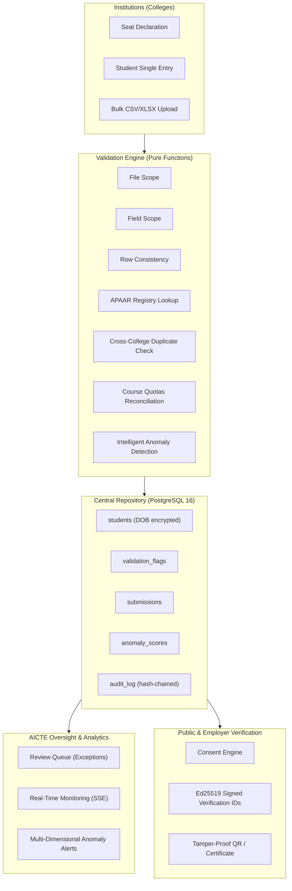

# APAAR Platform: System Architecture & Anomaly Detection

## 1. High-Level Architecture

The APAAR Student Data Management and Verification System is an automated platform enabling AICTE-approved higher educational institutions to submit, validate, monitor, and verify student enrolment data keyed by their 12-digit APAAR IDs.



---

## 2. Validation Engine Pipeline

Validation is executed sequentially following the **cheap-checks-first hierarchy** defined in SPEC.md Section 9.4:

1. **File Scope (`file`)**: Template header conformity (`FILE_TEMPLATE`), file presence (`FILE_EMPTY`), max row limits (`FILE_TOO_LARGE`), intra-file duplicate APAARs (`DUP_APAAR_IN_FILE`), and duplicate enrolment numbers (`DUP_ENROLNO_IN_COURSE`).
2. **Row Scope (`row`)**: 12-digit format (`APAAR_FORMAT`), presence (`APAAR_REQUIRED`), name syntax (`NAME_FORMAT`), date of birth validity (`DOB_INVALID`), enum constraints (`ENUM_INVALID`), foreign national country presence (`COUNTRY_REQUIRED`), admission window bounds (`ADMISSION_DATE_WINDOW`), fuzzy name matching (`APAAR_NAME_MISMATCH`), DOB reconciliation (`APAAR_DOB_MISMATCH`), category conflict (`CATEGORY_CONFLICT`), and course authorization (`COURSE_NOT_APPROVED`).
3. **Course Scope (`course`)**: Approved intake ceiling (`INTAKE_EXCEEDED`), supernumerary limits (`SUPERNUMERARY_EXCEEDED`), and college declared seats reconciliation (`SEAT_DECLARATION_MISMATCH`).
4. **Cross-College Scope (`cross`)**: Inter-institutional duplicate enrolments (`DUP_ACTIVE_OTHER_COLLEGE`, `DUP_SAME_COURSE_OTHER_COLLEGE`).
5. **Anomaly Scope (`anomaly`)**: Statistical threshold deviations and multi-dimensional Machine Learning isolation scoring.

---

## 3. Intelligent Anomaly Detection Subsystem

Per SPEC.md Section 9.3 and TASKS.md T27, the anomaly detection engine identifies statistical and institutional pattern anomalies. Anomaly flags are non-blocking for college submissions (`requires_justification=False`), with audience `aicte`, alerting supervisory officers to systemic irregularities.

### 3.1 Rule Catalogue (Anomaly Scope)

| Rule Code | Scope | Default Level | Threshold | Description |
|---|---|---|---|---|
| `ANOM_ENROLMENT_JUMP` | `anomaly` | `warning` | > 30.0% | Year-over-year enrolment increase exceeding threshold compared to previous academic year. |
| `ANOM_NRI_SHARE` | `anomaly` | `warning` | > 25.0% | Disproportionate proportion of NRI, OCI, and foreign national candidates. |
| `ANOM_SUPERNUM_SHARE` | `anomaly` | `warning` | > 15.0% | Supernumerary seat utilization exceeding expected statutory norms. |
| `ANOM_DOB_CLUSTER` | `anomaly` | `warning` | $\ge$ 5 students | Multiple candidates in the same course sharing the identical date of birth. |
| `ANOM_SEQUENTIAL_APAAR` | `anomaly` | `warning` | $\ge$ 10 consecutive | Consecutive contiguous blocks of 12-digit APAAR IDs suggesting synthetic batch generation. |
| `ANOM_SAME_ADMISSION_DAY` | `anomaly` | `info` | $\ge$ 60.0% | High concentration of students admitted on a single calendar day. |
| `ANOM_MODEL_SCORE` | `anomaly` | `warning` | Score < -0.05 | Multivariate IsolationForest outlier score indicating unusual multi-dimensional profile. |

---

### 3.2 Machine Learning Model: IsolationForest (`ANOM_MODEL_SCORE`)

The multivariate anomaly model uses scikit-learn's **IsolationForest** (`sklearn.ensemble.IsolationForest`). Unlike distance-based or density-based estimators, IsolationForest explicitly isolates anomalies by constructing ensembles of random partition trees. Since anomalies represent minority instances with atypical attribute values, they require significantly fewer splits to isolate and appear near the root of the decision trees.

#### Mathematical Foundation

Given an ensemble of $T$ isolation trees over a dataset of $n$ instances:

1. **Path Length $h(x)$**: The number of edges traversed from the root node to the terminating leaf node for instance $x$.
2. **Average Path Length $c(n)$**: The average path length of unsuccessful searches in a Binary Search Tree (BST):
   $$c(n) = 2 \ln(n - 1) + 0.5772156649\ (\text{Euler-Mascheroni constant}) - \frac{2(n - 1)}{n}$$
3. **Anomaly Score $s(x, n)$**:
   $$s(x, n) = 2^{-\frac{E(h(x))}{c(n)}}$$
   - When $E(h(x)) \to 0$, $s \to 1$ (strong anomaly).
   - When $E(h(x)) \to c(n)$, $s \to 0.5$ (normal instance).
   - In scikit-learn's `decision_function(x)`: scores are shifted such that negative values correspond to anomalies ($s > 0.5$) and positive values correspond to normal inliers.

#### Model Hyperparameters

- `n_estimators`: 100 decision trees.
- `contamination`: 0.08 (expected proportion of institutional outliers).
- `random_state`: 42 (deterministic reproducibility).
- `bootstrap`: False.

---

### 3.3 6-Dimensional Feature Vector Formulation

For every college-course combination $(I, C)$ in academic year $Y$:

$$\mathbf{X}_{(I, C, Y)} = \begin{bmatrix} x_{\text{yoy}}, & x_{\text{nri}}, & x_{\text{super}}, & x_{\text{dob}}, & x_{\text{adm}}, & x_{\text{seq}} \end{bmatrix}^T$$

1. **Year-over-Year Growth ($x_{\text{yoy}}$)**:
   $$x_{\text{yoy}} = \frac{N_{\text{active}}(I, C, Y) - N_{\text{active}}(I, C, Y-1)}{\max(N_{\text{active}}(I, C, Y-1), 1)}$$
   Measures sudden unapproved expansions in enrolment capacity.

2. **International Quota Share ($x_{\text{nri}}$)**:
   $$x_{\text{nri}} = \frac{N_{\text{intl}}(I, C, Y)}{N_{\text{active}}(I, C, Y)}$$
   Where $N_{\text{intl}}$ counts students with $\text{NRI}=\text{Yes}$, $\text{OCI}=\text{Yes}$, $\text{Foreign National}=\text{Yes}$, or international admission quota mode.

3. **Supernumerary Share ($x_{\text{super}}$)**:
   $$x_{\text{super}} = \frac{N_{\text{supernumerary}}(I, C, Y)}{N_{\text{active}}(I, C, Y)}$$
   Monitors disproportionate claims of Tuition Fee Waiver (TFW) or special category seats.

4. **DOB Cluster Ratio ($x_{\text{dob}}$)**:
   $$x_{\text{dob}} = \frac{\max_{d \in \text{DOBs}} \text{count}(d)}{N_{\text{active}}(I, C, Y)}$$
   Detects unnatural demographic clustering or identity forgery where multiple candidates share a single birthdate.

5. **Admission-Day Concentration ($x_{\text{adm}}$)**:
   $$x_{\text{adm}} = \frac{\max_{t \in \text{Dates}} \text{count}(t)}{N_{\text{active}}(I, C, Y)}$$
   Identifies single-day admission spikes outside authorized central counseling windows.

6. **Sequential APAAR Run Length ($x_{\text{seq}}$)**:
   $$x_{\text{seq}} = \max_{k} \left| \{ a_i \mid a_{j+1} = a_j + 1 \} \right|$$
   Identifies consecutive arithmetic series of national 12-digit student IDs indicative of bulk robotic identity provisioning.

---

### 3.4 Storage & Anomaly Persistence

Anomaly features and scores are persisted in the PostgreSQL `anomaly_scores` table:

```sql
CREATE TABLE anomaly_scores (
    id SERIAL PRIMARY KEY,
    institution_id INTEGER NOT NULL REFERENCES institutions(id) ON DELETE CASCADE,
    course_id INTEGER NOT NULL REFERENCES courses(id) ON DELETE CASCADE,
    academic_year VARCHAR(20) NOT NULL,
    score DOUBLE PRECISION NOT NULL,
    features_json JSONB NOT NULL,
    flagged BOOLEAN NOT NULL DEFAULT FALSE,
    created_at TIMESTAMP WITH TIME ZONE DEFAULT NOW(),
    updated_at TIMESTAMP WITH TIME ZONE DEFAULT NOW(),
    CONSTRAINT uq_anomaly_scores_inst_course_year UNIQUE (institution_id, course_id, academic_year)
);
```

### 3.5 Plain-English Explanation Synthesis

Every flagged anomaly generates an actionable plain-English explanation highlighting the exact feature deviations:
- *"Enrolment jumped from 80 in 2025-26 to 160 in 2026-27 (+100.0%), exceeding the 30.0% threshold."*
- *"Cluster of 8 students sharing the exact date of birth 2005-08-15 (threshold: 5)."*
- *"Sequential run of 12 APAAR IDs detected (990000000101 to 990000000112), exceeding threshold of 10."*
- *"IsolationForest anomaly model flagged unusual multi-dimensional course profile (score: -0.142; Enrolment growth +100.0%, sequential run of 12 APAAR IDs)."*
