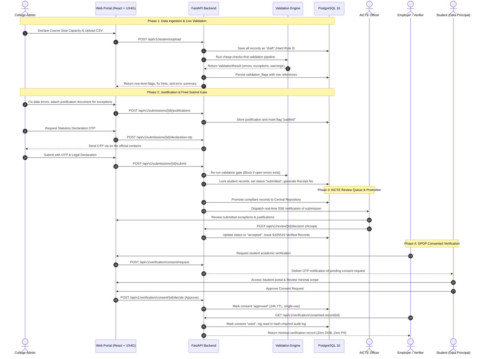

```mermaid
flowchart TD
    subgraph Clients["Stakeholders & Ingestion Clients"]
        U1["College Admin & Staff (Web UI)"]
        U2["AICTE Compliance Officers & Admins (Web UI)"]
        U3["Authorized Verifiers / Employers (Web UI)"]
        U4["Enrolled Students (DPDP Consent Portal)"]
        U5["Institutional ERPs (Bulk JSON API Client)"]
    end

    subgraph Edge["Security, Network & Gateway Layer"]
        MW1["SecurityHeadersMiddleware (HSTS, CSP, X-Frame)"]
        MW2["RequestBodySizeLimiterMiddleware (15MB Limit)"]
        MW3["CORS Policy Enforcement (Strict Origin Whitelist)"]
        MW4["Redis Sliding-Window Rate Limiter (ZSET)"]
        MW5["ApaarIdMaskingFilter (Runtime Log Redaction)"]
    end

    subgraph Backend["FastAPI Core Application Services"]
        S_AUTH["Auth & MFA Engine (Argon2id, JWT, pyotp)"]
        S_INST["Institution & Intake Management Service"]
        S_VAL["Automated Validation Engine (Pure Rules)"]
        S_SUB["Submissions State Machine & Gatekeeper"]
        S_REV["AICTE Review Queue & Query Engine"]
        S_ANOM["Anomaly Detection & IsolationForest ML"]
        S_CRYPTO["Cryptographic Signing & QR Service (Ed25519)"]
        S_VERIF["DPDP Student Consent & Verification Service"]
        S_REP["Statutory Reporting Engine (CSV, XLSX, PDF)"]
        S_AUDIT["SHA-256 Hash-Chained Audit Logger"]
    end

    subgraph Persistence["State & Persistence Layer"]
        DB[("PostgreSQL 16 Database
        (26 Tables, Encrypted DOB, Foreign Keys)")]
        CACHE[("Redis 7 In-Memory Cache
        (OTP TTL, Sliding Window, SSE Pub/Sub)")]
        STORAGE["Local File Storage
        (Content-Addressable Evidence Documents)"]
    end

    subgraph Interfaces["External Integration Interfaces & Mocks"]
        I_APAAR["ApaarClient (Batched Registry Lookup)"]
        I_AICTE["AicteMasterClient (30 Colleges, Master Sync)"]
        I_OTP["OtpSender (Redis TTL & dev_outbox Logging)"]
        I_ID["IdentityVerifier (Signatory Verification)"]
        I_STORE["Storage (Local Disk / S3 Compatible)"]
    end

    Clients --> Edge
    Edge --> Backend
    Backend --> Persistence
    Backend --> Interfaces
```

# EduTrace System Architecture

System topology, data lifecycle, validation pipeline, anomaly detection, API endpoints, and DPDP privacy architecture.

---

## 1. High-Level Architecture & Topology

The platform uses a vertical-slice design connecting institutions, AICTE regulatory officers, employers, and students.

---

## 2. Ingestion & Verification Lifecycle

---

## 3. Validation Engine Architecture

The validation engine runs a cheap-checks-first pipeline across single student entry, CSV uploads, ERP integration, and final submit gates:

1. **File scope**: Template conformity (`FILE_TEMPLATE`), empty file check (`FILE_EMPTY`), max row limits (`FILE_TOO_LARGE`), and in-file duplicate checks (`DUP_APAAR_IN_FILE`, `DUP_ENROLNO_IN_COURSE`).
2. **Row scope**: Format syntax (`APAAR_FORMAT`, `NAME_FORMAT`, `DOB_INVALID`, `ENUM_INVALID`), required values (`APAAR_REQUIRED`, `NAME_REQUIRED`, `COUNTRY_REQUIRED`), registry checks (`APAAR_NOT_FOUND`, `APAAR_DOB_MISMATCH`), fuzzy name matches (`APAAR_NAME_MISMATCH`), admission window (`ADMISSION_DATE_WINDOW`, `ADMISSION_YEAR_MISMATCH`), course approval (`COURSE_NOT_APPROVED`), and demographic consistency (`CATEGORY_CONFLICT`, `AGE_OUT_OF_RANGE`, `SEAT_TYPE_NOT_APPROVED`, `MODE_CATEGORY_MISMATCH`).
3. **Course scope**: Capacity enforcement (`INTAKE_EXCEEDED`), supernumerary limits (`SUPERNUMERARY_EXCEEDED`), and seat declaration matching (`SEAT_DECLARATION_MISMATCH`).
4. **Cross-college scope**: Inter-institutional duplicate enrolments (`DUP_ACTIVE_OTHER_COLLEGE`, `DUP_SAME_COURSE_OTHER_COLLEGE`) against the central index on `(apaar_id, academic_year)`.
5. **Anomaly scope**: Statistical growth spikes, demographic clusters, contiguous sequential APAAR numbers, and unsupervised ML outlier scoring.

Severity levels:
- **`error`**: Blocks submission. Data must be corrected.
- **`exception`**: Blocks submission unless written justification and proof documents are attached.
- **`warning`**: Permitted to submit with optional justification.
- **`info`**: Informational observation; submit is allowed.

---

## 4. Intelligent Anomaly Detection

Monitors institutional admission data across statistical bounds and unsupervised machine learning:

- `ANOM_ENROLMENT_JUMP`: Year-over-year enrolment jump exceeding statutory limit (> 30%).
- `ANOM_NRI_SHARE`: NRI, OCI, and foreign national admissions exceeding 25% quota share.
- `ANOM_SUPERNUM_SHARE`: Supernumerary admissions exceeding 15% quota share.
- `ANOM_DOB_CLUSTER`: 5 or more students in the same course sharing an identical date of birth.
- `ANOM_SEQUENTIAL_APAAR`: 10 or more consecutive contiguous APAAR IDs.
- `ANOM_SAME_ADMISSION_DAY`: 60% or more students admitted on a single calendar day.
- `ANOM_MODEL_SCORE`: Multivariate IsolationForest outlier score ($< -0.05$).

### IsolationForest Model

Uses scikit-learn's `IsolationForest` over 6 normalized features ($x_{\text{yoy}}, x_{\text{nri}}, x_{\text{super}}, x_{\text{dob}}, x_{\text{adm}}, x_{\text{seq}}$). The anomaly score is computed as:
$$s(x, n) = 2^{-\frac{E(h(x))}{c(n)}}$$
Negative scores identify multidimensional outliers across institutional admissions.

---

## 5. REST API Architecture & Endpoint Reference

Key endpoints exposed under `/api/v1`:

| Area | Endpoint | Method | Role | Description |
|---|---|---|---|---|
| **Health** | `/api/v1/health` | GET | Public | Database, Redis, and demo mode connectivity check. |
| **Auth** | `/api/v1/auth/login` | POST | Public | Authenticate with email/password; prompts MFA if required. |
| **Upload** | `/api/v1/students/upload` | POST | College | Bulk upload student records via CSV/XLSX. |
| **Submit** | `/api/v1/submissions/{id}/submit` | POST | College Admin | Final submission gate with OTP and statutory declaration. |
| **Stream** | `/api/v1/analytics/stream` | GET | AICTE | Real-time Server-Sent Events (SSE) submission and alert feed. |
| **Verify** | `/api/v1/verification/verify` | GET | Public | Verify Ed25519 cryptographic credential by Verification ID or QR. |
| **Audit** | `/api/v1/audit/verify-chain` | GET | AICTE Admin | Verify cryptographic SHA-256 hash chain across audit logs. |

---

## 6. Digital Personal Data Protection (DPDP) Privacy Architecture

Built under India's Digital Personal Data Protection Act, 2023:

- **Data Fiduciary**: All India Council for Technical Education (AICTE), regulatory authority over technical education.
- **Data Principal**: The student, uniquely identified by their 12-digit APAAR ID.
- **Data Processor**: Accredited prospective employers and background check agencies.

### Data Minimisation

The system collects only 16 statutory fields necessary for quota validation:
- **Identity (4)**: `apaar_id`, `name`, `dob`, `gender`
- **Admission (7)**: `course`, `branch`, `admission_year`, `enrolment_no`, `admission_date`, `admission_mode`, `seat_type`
- **Category (5)**: `reservation_category`, `nri`, `oci`, `foreign_national`, `country` (foreign nationals only)

Aadhaar numbers, parent information, addresses, income, and biometric data are never collected.

### Privacy Safeguards

1. **Encryption at rest**: Student date of birth is symmetrically encrypted using Fernet (AES-128-CBC with HMAC-SHA256).
2. **Runtime log masking**: APAAR numbers are redacted in logs to `********<last4>`.
3. **Consented verification**: Verifiers access minimal academic tuples (`institution`, `course`, `years`, `status`) only after student OTP consent. Tokens expire in 24 hours and are single-use.
4. **Audit chain**: All data mutations and verifier reads record immutable SHA-256 chained audit entries.

Grievance Redressal: Data Protection Officer, `dpo@aicte-india.org`.
